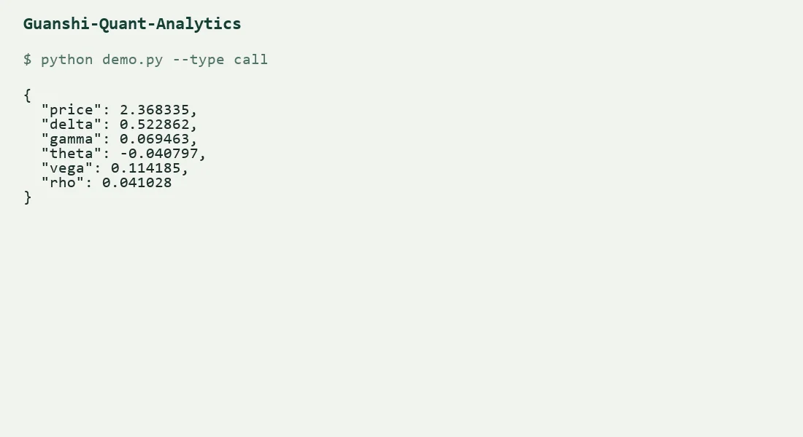
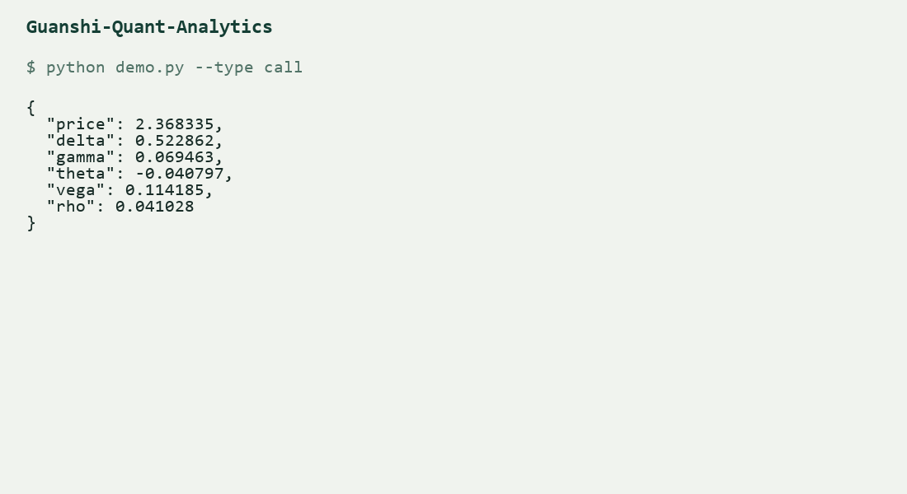
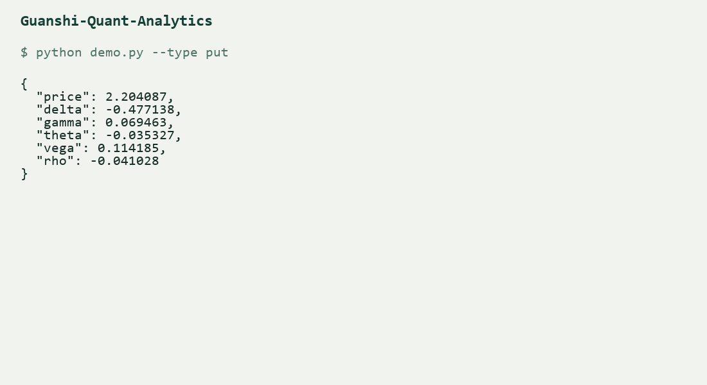

# 观市 Quant 期权分析组件

使用观市量化工作台原有的本地定价函数，输入标的、行权价、期限、波动率和利率，输出价格与希腊值。

## 运行输出



上图由两张本次实际命令输出排版轮换组成，不是连续操作录像。

| 看涨演算 | 看跌演算 |
| --- | --- |
|  |  |

## 可以做什么

- 独立 Python 模块，不依赖数据接口
- 输入验证拒绝非正价格与期限
- 切换 call 与 put，返回 JSON

## 本地运行

```sh
python demo.py --type call
python demo.py --type put
```

## 实测与范围

两组示例均由原有定价函数现场输出，检查了价格和 delta 的方向。

波动率、利率为百分数，期限以天为单位。只演示定价组件，不含行情订阅、券商下单或原量化工作台全部模块。

[授权范围](LICENSE) · [来源与署名](NOTICE.md)
